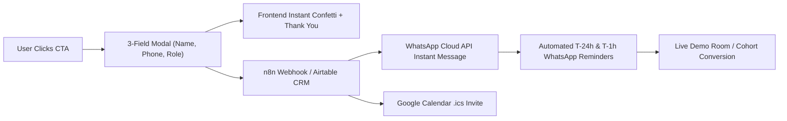
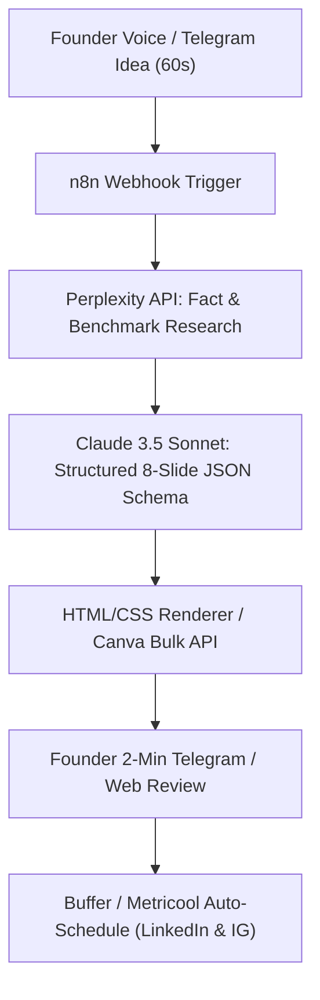

# Founder Ecosystem Suite: Practo for Animals & AI Education Platform

**Internship Candidate Assignment Submission**  
**Role:** Product Development, Design & AI Systems Intern  
**Tech Stack:** React 18, Vite, TypeScript, Tailwind CSS, Lucide Icons, html-to-image, jsPDF, canvas-confetti.  

---

## 🌟 Live Demo & Architecture Summary

This unified web application brings together the three core pillars of the founder's vision into a single high-performance digital ecosystem:

| Route | Product Name | Primary Focus | Visual Identity |
|---|---|---|---|
| `/` | **Submission Hub** | Executive overview & rubric alignment | Deep Slate & Emerald |
| `/animals` | **PawPulse Health** | Practo for Animals MVP (Clinics, 24/7 ICU, Ambulances, Map) | Earthy Medical Teal (`#0F766E`) & Warm Sand (`#FAF8F5`) |
| `/ai-course` | **CogniShift AI Academy** | Conversion landing page for applied AI bootcamps & lead flow | Obsidian Slate (`#0B0F19`) & Cyber Indigo (`#6366F1`) |
| `/carousel` | **AI Content Studio** | 1080x1350 carousel engine, live editor & PDF/PNG export | Creative Dark Studio & Amber Data Badges |
| `/overview` | **Written Strategy** | MoSCoW prioritization, automation flow & 30-day roadmap | Executive Document Layout |

---

## 🐾 Part 1: Practo for Animals (PawPulse) — Product & Design Rationale

### 1. The Core Problem
Animal healthcare in India is plagued by **severe time asymmetry, high emotional panic**, and fragmented clinic data. When a pet suffers acute gastric dilation (GDV) or a street animal is struck by a vehicle at midnight, 90% of neighborhood clinics are closed, and pet parents have no reliable way to verify who has an active oxygen ICU or surgical team on call.

### 2. Essential MVP Elements & Architecture
- **Pulsing Emergency Strip:** Persistent high-visibility banner featuring a 1-tap trigger for 24/7 emergency trauma centers and animal ambulance dispatch (dialing 1962 / local trauma van).
- **Service & Species Pinpoint Search:** Search by locality, vet name, or clinical keyword across 6 care categories:
  1. *Veterinary Clinics* (General OPD & vaccinations)
  2. *24/7 Emergency Hospitals* (Surgeries, oxygen ICU, overnight inpatient)
  3. *Animal Ambulances* (Critical trauma transit, mobile van)
  4. *Pet Boarding & Daycare* (Cage-free farm stays, CCTV-monitored kennels)
  5. *Diagnostic Labs & Imaging* (CBC, digital X-Ray, ultrasonography)
  6. *NGO Shelters & Rescues* (Animal Birth Control, cruelty interventions, strays)
- **Interactive List + Map Toggle:** Realistic interactive vector map with geolocation pins, 24/7 pulsing rings, radius filtering, and popover clinic cards.
- **High-Trust Provider Card:** Displays VCI verification license, real consultation fee (`₹600 / visit`), distance, live open/closed status, and animal species tags.
- **Touch-Optimized CTAs (≥48px):** 1-tap **Call Now**, **WhatsApp Chat**, **Google Directions**, and **Book / Enquire**.
- **Crowdsourced Data Integrity Loop:** 
  - *"Submit a Correction" Modal:* Allows pet parents or veterinarians to submit real-time updates (wrong number, changed timings, shifted location).
  - *"List Your Business" Multi-Step Onboarding:* 3-step streamlined onboarding for clinics, boarding facilities, and NGOs with VCI registration verification.
- **In-Page Design Rationale Drawer:** Accessible via the floating bottom button to explain MVP scope, mobile UX, and supply-side moats.

### 3. What Was Deliberately Left Out of V1 (And Why)
1. **In-App Prepayments / Escrow:** In India, forcing users to pay ₹600 upfront via a payment gateway causes massive abandonment during emergency panic. Furthermore, emergency surgeries preempt routine OPD appointments, leading to messy refund disputes.
2. **Synchronous Video Teleconsultations:** Standalone clinics rarely have the hardware or indemnity insurance setup for video consults in Week 1. Physical discovery was prioritized.
3. **E-Commerce Pet Store:** Dilutes clinical trust and distracts from building the verified supply-side directory moat.

---

## ⚡ Part 2: AI Education Course Landing Page (CogniShift AI Academy)

### 1. Value Proposition & Structure
- **Target Audience:** College students, fresh graduates, working software engineers, product managers, and founders looking for practical AI automation and agentic skills.
- **Conversion-Driven Architecture:**
  - Sticky nav with cohort urgency badge (`Starts Nov 23 • Only 8 Seats Remaining`)
  - Hero with dual CTAs: **"Reserve Your Seat (₹7,999)"** and **"Book Free 45-Min Demo"**
  - Concrete curriculum roadmap: Week-by-week deep dive covering **n8n, Make, Claude 3.5 Sonnet Tool Calling, Model Context Protocol (MCP)**, and Vite/React deployment
  - Live Capstone Portfolio Showcase: Displays real student products (WhatsApp Stray Triage Bot, AI Social Content Engine, Legal Contract Analyzer)
  - Transparent 3-tier pricing (Self-Paced ₹3,499, Live Cohort ₹7,999, Career Fellowship ₹14,999) backed by a **7-Day 100% Money-Back Guarantee**
  - Floating WhatsApp admissions concierge button

### 2. The Lead-Capture & Automated Backend Journey

1. **Frontend Capture:** Clean 3-field form collecting Name, WhatsApp Number, and Current Role/Goal.
2. **Instant Gratification:** Celebratory confetti and an immediate thank-you view with a direct link to join the private WhatsApp community.
3. **Backend Automation Engine (n8n/Make):**
   - The submission webhook triggers an entry in the CRM (Airtable / Google Sheets) tagged by cohort batch and source UTM.
   - The WhatsApp Cloud API fires an automated personalized confirmation within 4 seconds containing the Zoom demo link.
   - A Google Calendar invite (.ics) is automatically dispatched via email.
   - Scheduled cron nodes send automated WhatsApp reminders at T-24 hours and T-1 hour before the session.

---

## 🎨 Part 3: AI Carousel Content System

### 1. Sample 9-Slide Carousel
- **Topic:** *"How AI is Changing Animal Healthcare in India"*
- **Aspect Ratio:** Standard 1080x1350 (4:5 portrait) optimized for mobile thumb-stopping feeds on LinkedIn and Instagram.
- **Narrative Arc:**
  - *Slide 1 (The Hook):* "India has only 1 vet for every 8,000 animals. Here is how AI is closing the care gap."
  - *Slide 2 (The Bottleneck):* The 3 fatal bottlenecks: panic triage blindness, the 8:30 PM nighttime black hole, and missing radiologists.
  - *Slide 3 (Breakthrough 1):* 24/7 Multimodal Triage via WhatsApp (photos/videos to clinical triage color codes in 8 seconds).
  - *Slide 4 (Breakthrough 2):* Edge AI Radiology from smartphone camera shots of analog X-ray view-boxes (96.2% concordance).
  - *Slide 5 (Breakthrough 3):* Street-level computer vision heatmaps for municipal stray dog rabies and vaccination drives.
  - *Slide 6 (Breakthrough 4):* Vernacular Voice AI for 80M Indian dairy farmers in Kannada, Hindi, and Marathi to stop cattle mastitis.
  - *Slide 7 (Breakthrough 5):* The Ambient AI Scribe saving 4 hours of daily veterinarian paperwork.
  - *Slide 8 (The Verdict):* "AI will not replace Indian veterinarians. It will empower the top 10% to treat 10x more lives."
  - *Slide 9 (Dual CTA):* Discover verified care on PawPulse and enroll in CogniShift AI Academy.

### 2. Interactive Component & Multi-Page Export
- **Editable HTML/CSS:** Slide headlines and subtitles are editable in real-time in the web studio.
- **Theme Switcher:** Toggle between *Obsidian Slate*, *Clinical Emerald*, and *Minimal Clean*.
- **Client-Side Export:**
  - One-click **Export Slide as High-Res PNG** using `html-to-image`.
  - One-click **Export All as Multi-Page PDF** (1080x1350) using `jspdf` + `html-to-image` for native LinkedIn Document uploads.
- **Social Distribution:** Publish-ready caption and hashtag block copyable with a single tap.

### 3. Repeatable 6-Stage AI Content Workflow


### 4. Tool Stack & Unit Economics Comparison

| Tool | Category | Cost | Why Chosen |
|---|---|---|---|
| **Claude 3.5 Sonnet** | Copywriting Engine | $0.03 / carousel (~₹2.50) | Flawless JSON schema output, crisp non-generic tone |
| **Perplexity API** | Factual Verification | $0.01 / query (~₹0.85) | Real-time Indian healthcare citations & statistics |
| **n8n (Self-Hosted)** | Workflow Automation | $5 - $20 / month flat | Visual canvas, zero per-task execution fees |
| **HTML5 / jsPDF** | Render & Export Engine | Free ($0) | Direct browser-based PNG/PDF generation without Canva limits |
| **Buffer / Metricool** | Social Distribution | Free tier / $18 mo | Native LinkedIn multi-page PDF document posting |

> **ROI Summary:** Traditional design agency takes **24–48 hours** and costs **₹1,800–₹3,500 per carousel**. This automated pipeline finishes in **12 minutes** for **~₹15 per carousel**, representing a **99% cost reduction** and a **10x publishing cadence**.

---

## 📅 First 30 Days Founder Roadmap

- **Week 1: Cold-Start Supply Seeding & Data Moat**
  - Aggregate and manually verify 500 veterinary clinics, 24/7 hospitals, and animal NGOs across Bangalore and Mumbai.
  - Distribute the crowdsourced "Submit a Correction" loop across local rescue WhatsApp groups.
- **Week 2: WhatsApp AI Triage Assistant MVP**
  - Connect n8n with Claude 3.5 Sonnet to build a WhatsApp triage bot that provides first-aid guidance and routes urgent cases to the nearest open hospital.
- **Week 3: AI Course Cohort 1 Pre-Sale Webinar**
  - Host a live 60-minute hands-on webinar ("Build a 2-Way WhatsApp AI Agent in 45 Mins") targeting 30 paid student registrations.
- **Week 4: Automated Organic Engine & Programmatic SEO**
  - Launch 3 automated carousels/week on LinkedIn and publish programmatic landing pages (e.g., *"Best 24/7 Vets in Indiranagar"*, *"Pet Ambulance in Bandra"*) to drive organic patient acquisition.

---

## 🚀 Local Development & Build Instructions

```bash
# Clone the repository
git clone <repo-url>
cd Itern_aasignment

# Install dependencies
npm install

# Start Vite development server
npm run dev

# Build production bundle
npm run build

# Preview production build locally
npm run preview
```

---

## 📝 Assumptions Made
1. **Focus Metros:** Seed data is centered on Bangalore (Indiranagar, Koramangala, HSR Layout, Whitefield, Jayanagar, Hebbal) with multi-city support for Mumbai, Delhi-NCR, Pune, and Hyderabad.
2. **Pricing Transparency:** In-clinic consultation fees are displayed in INR (`₹150 - ₹900`) reflecting realistic Indian veterinary pricing.
3. **No-Login Discovery:** Basic search and emergency ambulance lookups require zero authentication to ensure immediate life-saving care during emergencies.

